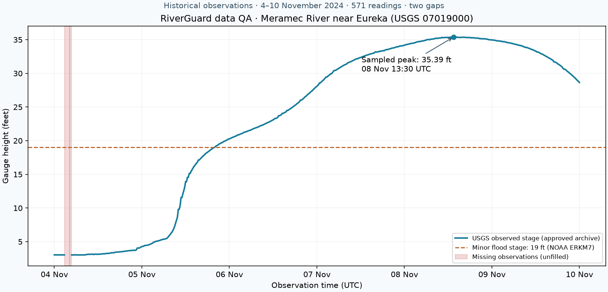

# Agent 1: shared river observations

Public interface: `from riverguard.data import load_stage`. Run from the repository root with Python 3.11+:

```sh
python -m pip install -r riverguard/data/requirements.txt
python -m pip install pytest
python -m pytest tests/test_data.py -q
```

Validated locally with Python 3.12.14, pandas 3.0.6 and pytest 9.1.1. The package uses Python's namespace-package support, so no root `riverguard/__init__.py` is required.

```python
from riverguard.data import load_stage, load_fixture, observations_as_of, quality_report

observations = load_stage("07019000", "2024-11-04", "2024-11-10")
# Columns: station_id (string), timestamp (timezone-aware UTC),
# stage_ft (float), quality (string: approval status and qualifier).

# Read the exact downloaded interval with no HTTP requests:
cached = load_stage("07019000", "2024-11-04", "2024-11-10", offline=True)

# A fresh clone can use the committed fixture without populating a cache:
sample = load_fixture()
past_only = observations_as_of(sample, "2024-11-05T18:00:00Z")
report = quality_report(past_only, expected_interval_minutes=15)
```

Bounds are inclusive. Date-only inputs mean **midnight UTC**, including `end`; use the next midnight to include a complete day. Naive datetimes are interpreted as UTC. Leading zeroes in station IDs are preserved; `USGS-07019000` is also accepted. Results are sorted chronologically and filtered to the requested bounds after fetching all pages. No resampling or interpolation occurs. Empty responses raise `DataUnavailableError` rather than returning invented observations.

The loader uses the [USGS continuous API](https://api.waterdata.usgs.gov/ogcapi/v1/collections/continuous), parameter `00065`. The [source field definitions](https://api.waterdata.usgs.gov/ogcapi/v1/collections/continuous/schema) describe units, observation time, approval status and qualifiers. Supported feet/metre readings are normalized to feet; unknown units or unexpected stations/parameters fail explicitly. USGS [plans to retire the older WaterServices endpoint in February 2027](https://waterservices.usgs.gov/), so it is only used by the optional cross-check script.

## Cache and provenance

Cache location defaults to `riverguard/data/.cache/`, ignored by Git. Override it with `RIVERGUARD_DATA_CACHE` or `cache_dir=`. Files are keyed by normalized station and exact UTC bounds; overlapping windows do not reuse one another's cache. Successful downloads are validated before atomic writes. A failed refresh leaves the prior cache intact. Network timeouts and transient HTTP errors have bounded retries; cache misses in offline mode fail without HTTP.

Calls read an existing cache first. Use `refresh=True` to obtain revised measurements; an old cache is never described as live data. Corrupt/mismatched caches fail with an explicit error; use an online refresh to repair them. `offline=True` and `refresh=True` are mutually exclusive. The DataFrame's `attrs` contains source URLs, retrieval time, units provenance, requested interval, duplicate count and cache status. Attributes may be lost when callers transform/export DataFrames; preserve the original JSON for audit.

```sh
python -m riverguard.data --start 2024-11-04 --end 2024-11-10 --fixture riverguard/data/fixtures/eureka-nov-2024.json
python -m riverguard.data --start 2024-11-04 --end 2024-11-10 --offline
```

The CLI supports `--station`, `--cache-dir`, `--csv`, `--refresh` and `--cadence-minutes`. CSV contains the four contract columns; it does not contain the JSON provenance envelope. Keep large exports outside Git.

## Missing data and replay safeguards

- Null, invalid, nonfinite and USGS no-data sentinel readings remain explicit NaN stages with `missing_value` quality annotations. Timestamps for absent readings are not manufactured.
- Equal duplicates collapse with their quality annotations combined; conflicting duplicates raise `DataQualityError` because the loader cannot safely select one sensor/time series.
- `quality_report` identifies internal gaps, missing requested-window boundary coverage, missing values, duplicate counts, extreme stages and rapid changes. Set the expected cadence for the station/window: 15 minutes for the November 2024 fixture, 30 minutes for the two older windows checked here. Gaps exceed 1.5 times that cadence. Bounds/rates are configurable review flags; they do not automatically discard flood peaks.
- `observations_as_of` selects only measurements at or before the prediction time. Model code must still enforce its own cutoff. Review gaps and staleness before forecasting; no gap-filling or feature engineering is performed here.
- Historical measurements downloaded today may contain later USGS revisions. This is a retrospective replay using observation timestamps, **not** an archived feed proving what was actually published at that historical instant.

## Verified source windows

The monitoring station is **Meramec River near Eureka, MO, USGS 07019000**. Source-labelled downloads and summaries were generated on 17 October 2026:

| UTC window, inclusive | Readings | Sampled peak (ft) | Coverage |
| --- | ---: | ---: | --- |
| 23 Dec 2015 – 10 Jan 2016 | 865 | 46.06 | No gaps at 30-minute cadence |
| 23 Apr – 12 May 2017 | 913 | 46.11 | No gaps at 30-minute cadence |
| 4–10 Nov 2024 | 571 | 35.39 | Two gaps at 15-minute cadence |

The older raw downloads stay in the ignored cache; their compact results are in `fixtures/historical-window-validation.json`. The committed November GeoJSON fixture is approximately 305 KB and preserves source properties and retrieval metadata. Its two gaps are 02:45–04:15 UTC (90 minutes) and 04:15–04:45 UTC (30 minutes) on 4 November. Its sampled peak is 35.39 ft at 13:30 UTC on 8 November, matching [NOAA ERKM7's published crest](https://api.water.noaa.gov/nwps/v1/gauges/ERKM7). NOAA also reports action/minor/moderate/major stages of 17/19/26/31 ft; these are reference stages, separate from any model probability.

`fixtures/source-crosscheck.json` records a second query to legacy USGS: all **567 overlapping observations match exactly**. The legacy response omitted the first four modern timestamps and returned four later timestamps beyond the modern interval. Comparing rows by position would therefore be incorrect. Modern OGC remains the pipeline's source; values were not replaced or averaged. Do not infer the cause of the boundary difference from this comparison alone.

The chart was visually reviewed: it preserves the two gaps, shows the rise through 19 ft and marks the sampled peak. Source samples were compared by timestamp, and NOAA independently confirms the crest time and height. Reproduce the optional chart and online source comparison with:

```sh
python -m pip install matplotlib
python -m riverguard.data.plot_fixture
python -m riverguard.data.verify_sources
```



USGS data are U.S. government public-domain data; retain source attribution and approval/qualifier information. Provisional readings can change. The sample supports integration and data QA; it does not establish forecast accuracy.

## Handoff to Agents 2 and 3

Agent 2 can call `load_stage` or `load_fixture` directly and apply its cutoff before creating features. Agent 3 can serialize each `timestamp` with `.isoformat()` and translate missing stages to JSON `null`; NaN is not valid JSON. Preserve feet internally under `stage_ft` and convert only at existing API boundaries that use metres (`stage_m = stage_ft * 0.3048`). The loader is synchronous; call it from a synchronous route or a worker thread when integrating with async endpoints.

The existing backend and dashboard were not modified. The backend's current Docker image only copies `backend/app` and `backend/data` and installs its own dependency file. To call this module in that container, the backend owner must include `riverguard/data` in the build context/image, install its pandas dependency, and add the adapter to the existing API. This branch provides the data component and fixture, not a deployed integration or model.
